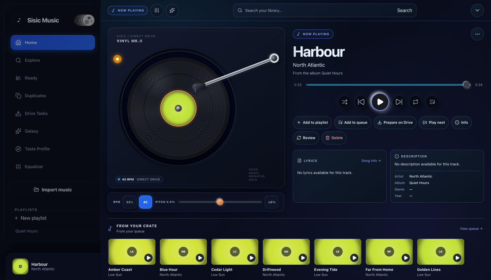
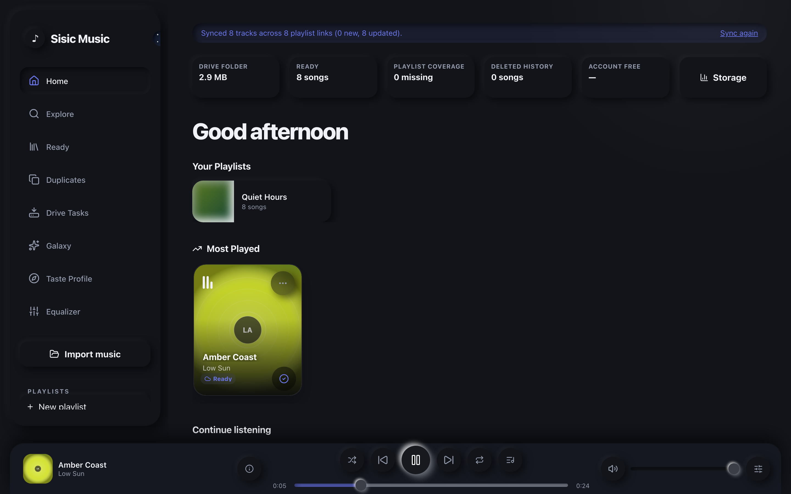
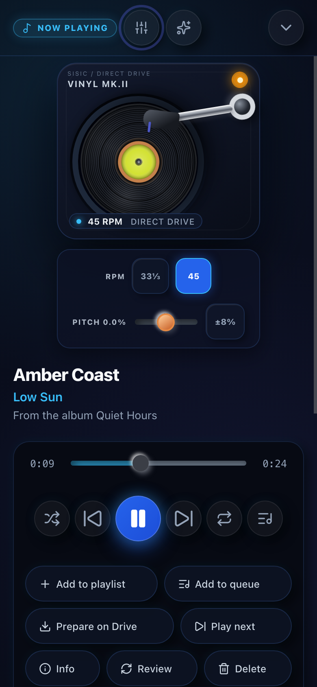

<div align="center">

# Sisic Music

**A free, self-owned, Spotify-style music library that lives in your own Google Drive.**
Static React app on GitHub Pages · Drive as storage · IndexedDB cache · optional Mac worker for downloads.

[**Live site**](https://siddhu-123.github.io/sisic-music/) · [Screenshots](#screenshots) · [Quick start](#quick-start) · [How it works](#how-it-works)



</div>

> **Heads up:** the live site is a personal app. It signs in with Google and reads *your* Drive, so a visitor sees the login screen unless they run their own copy with their own OAuth client (see [Quick start](#quick-start)). The screenshots below use fictional sample tracks.

## Features

- **Streams straight from Drive** with range requests. Whole songs are never loaded into memory or filled into device storage.
- **Interactive vinyl turntable**: 33⅓ / 45 RPM, tonearm follows progress, drag to scrub, lift the arm to pause, pitch control.
- **Playback engine** (`PlaybackController`): native streaming, preloading, crossfade, sleep timer, drag-to-reorder queue, Media Session lock-screen controls.
- **Library views**: Home, Explore, Ready (songs already on Drive), Duplicates, Drive Tasks, Galaxy (constellation view), Taste Profile, Equalizer.
- **Contextual recommender** that uses session length, skips, time of day and device context, with artist-diversity adjustments.
- **Adaptive DJ mode** (opt-in): beat/key-aware transitions with early crossfades. See [DJ_MODE.md](DJ_MODE.md).
- **Local import**: drop audio files or folders on the page. Files are identified by SHA-256, metadata is kept in IndexedDB, and the source is staged to Drive when signed in.
- **Queue and review flow**: missing songs become jobs for a local worker; ambiguous matches go to a review panel and your choice is remembered.
- **Neumorphic UI**, an original theme toggle, keyboard shortcuts, responsive layout from 320 px phones to desktop.

## Screenshots

| Home | Mobile player |
|---|---|
|  |  |

## Tech stack

React 19 · Vite · Dexie (IndexedDB) · lucide-react · Google Identity Services + Drive API v3 · Node's built-in test runner · ESLint. Deployed as static files to GitHub Pages.

## Quick start

Requires Node 20+.

```bash
git clone https://github.com/Siddhu-123/sisic-music.git
cd sisic-music
npm install
cp .env.example .env   # then fill in the three values below
npm run dev
```

`.env`:

```bash
VITE_GOOGLE_CLIENT_ID="your OAuth web client id"
VITE_SPOTIFY_JSON_FILE_ID="Drive file id for spotify_data.json"
VITE_DRIVE_FOLDER_ID="Drive folder id for Sisic audio and JSON indexes"
```

One-time Google Cloud setup: enable the Drive API, create a **Web** OAuth client, and add your dev origin (and the deployed Pages origin) as an authorized JavaScript origin. Keep `.env` out of version control (it is already in `.gitignore`).

### Scripts

| Command | What it does |
|---|---|
| `npm run dev` | Vite dev server |
| `npm run build` | Production bundle in `dist/` |
| `npm run lint` | ESLint |
| `npm test` | Unit tests (`node --test`) |
| `npm run test:browser` / `test:dj` | Browser verification scripts in `scripts/` |
| `npm run deploy` | Build and publish `dist/` to the `gh-pages` branch |

## How it works

1. The app syncs `spotify_data.json` (a Spotify library export) from Drive into IndexedDB.
2. Songs are keyed by `normalize(artist) + "::" + normalize(track)`.
3. Ready audio is read from the compact index `sisic-songs.json`. A deeper Drive scan only happens when playback or validation fails, which keeps Drive API traffic low.
4. A song that is not on Drive appends one job to the canonical `sisic-queue.json`.
5. A local **Mac worker** (Python, `yt-dlp`, FFmpeg) claims queued jobs, validates the result, uploads the MP3 to Drive and updates the indexes. Downloads over 8 minutes need confirmation. The worker is a separate companion and is not part of this repository yet.
6. Playlist edits are written to `sisic-playlists.json`; playback events go to `sisic-playback-log.json` with an offline outbox.

### Drive metadata files

| File | Purpose |
|---|---|
| `sisic-songs.json` | Compact source of truth for ready Drive audio |
| `sisic-queue.json` | Browser-visible queue summary for worker job state |
| `sisic-deleted.json` | Songs intentionally offloaded from Drive (never re-downloaded) |
| `sisic-playlists.json` | App-owned playlist membership |
| `sisic-playback-log.json` | Starts, pauses, seeks, stops, completions, errors, skips |
| `sisic-imports.json` | Metadata-only manifest for local imports |

## Project structure

```
src/
  App.jsx               app shell and routing between views
  components/           player bar, expanded player, turntable, queue, review panel, views
  hooks/                useAudioPlayer, useAuth, useAdaptiveDjMode, ...
  db.js                 Dexie schema
tests/browser/          browser-level checks
scripts/                verify-player.mjs, verify-dj.mjs
public/                 static assets, service workers (sw.js, stream-sw.js), unique_songs.json catalogue
DJ_MODE.md              adaptive DJ design notes
BUG_FIXES.md            log of notable fixes
```

## Known limitations

- Needs your own Google Cloud project and Drive folder; there is no hosted backend and no anonymous demo.
- Real offline mode and gapless playback are not finished.
- Lyrics are not wired up yet (the panel shows a placeholder).
- Lock-screen playback is reliable on Android; iPhone Chrome stops playback when the screen locks.
- Adaptive DJ's BPM/key data needs the worker's analysis backfill, which has not been run across a full library.

## Contributing

Issues and pull requests are welcome. Please run `npm run lint && npm test && npm run build` before opening a PR.

## License

[MIT](LICENSE) © 2026 Satya Siddhartha Balanagu
